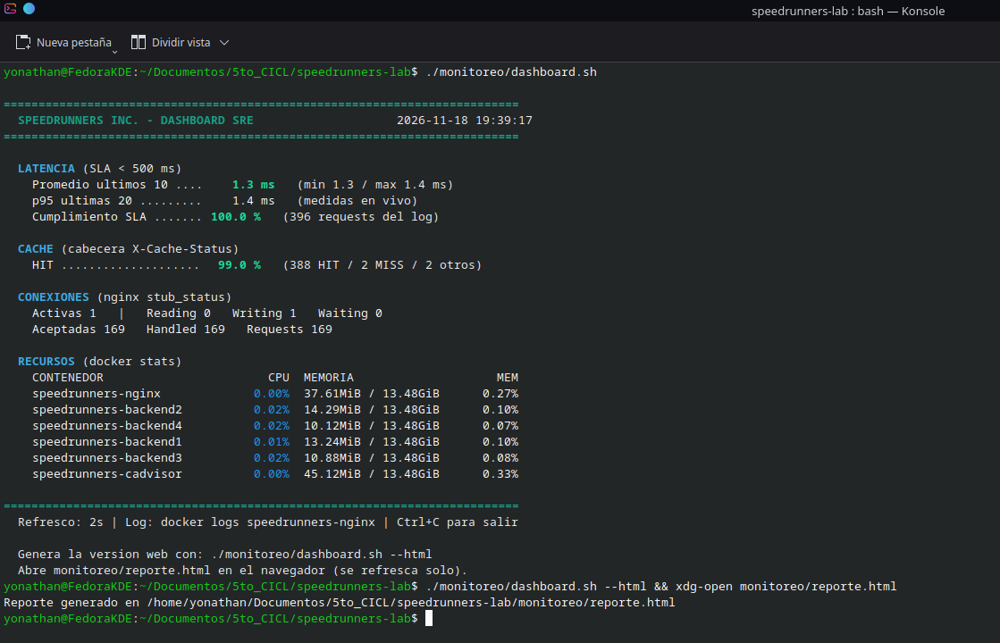
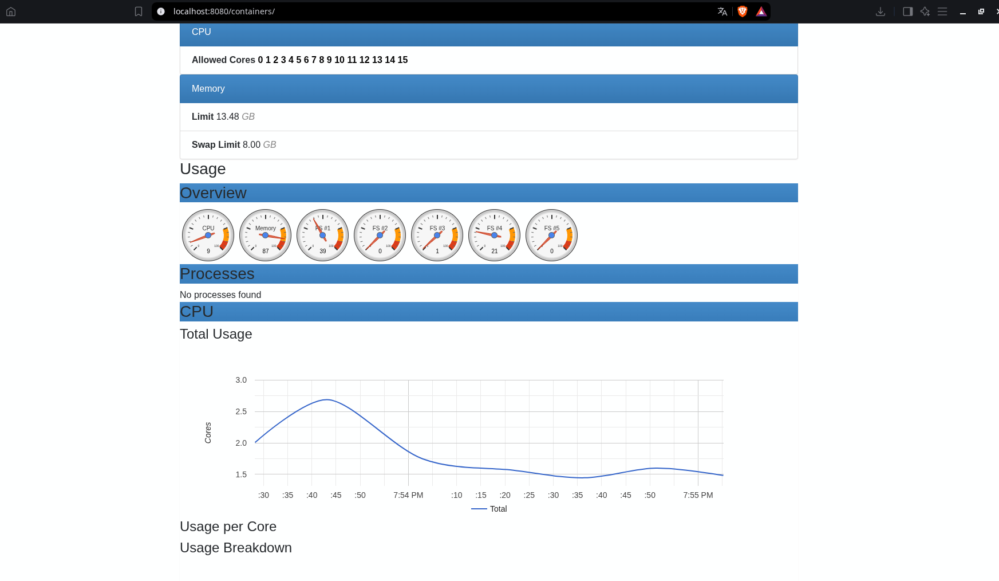
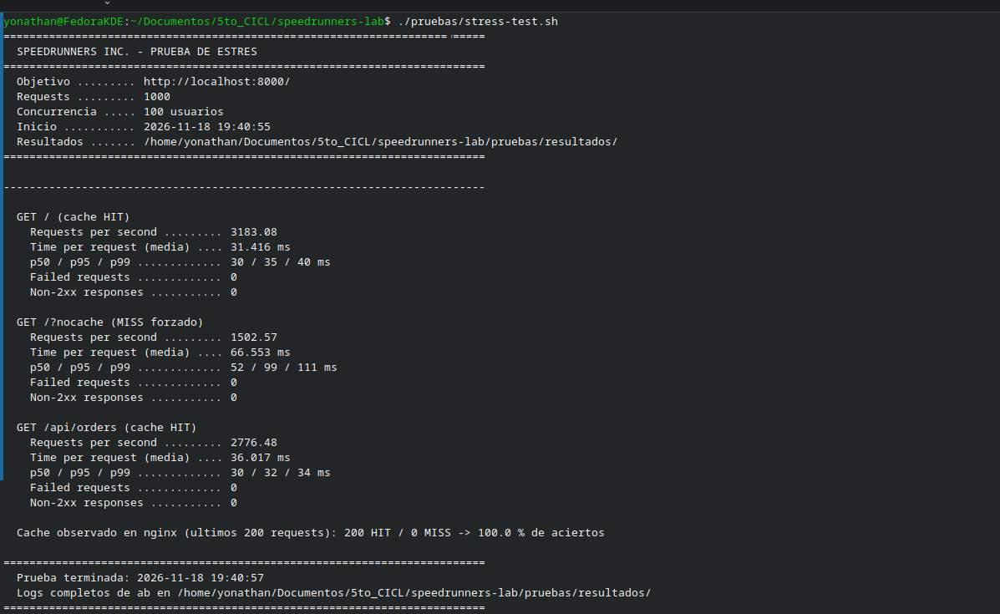
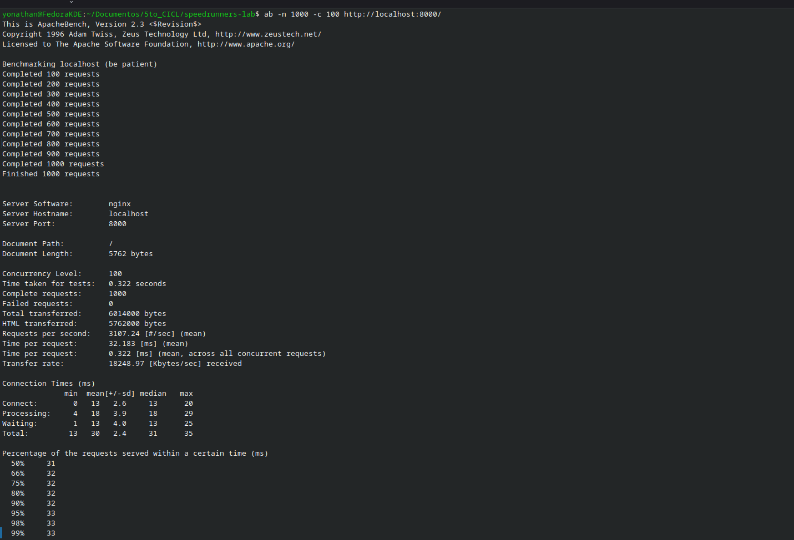
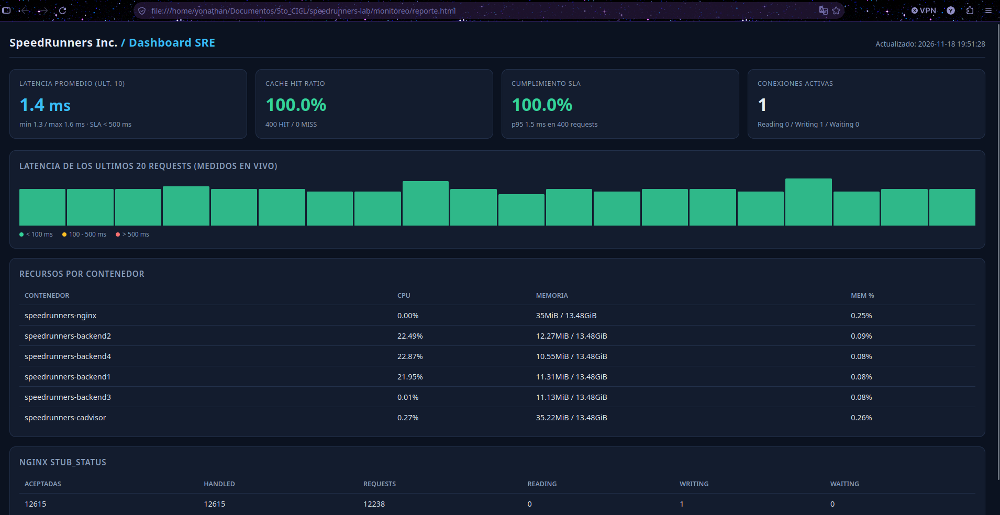

# INFORME - La Carrera contra el Reloj

**SpeedRunners Inc. — Optimización y monitoreo de infraestructura**
Nginx · Docker · ApacheBench · cAdvisor

---

## 1. Resumen

Línea base: 2 backends con 500 ms de delay, sin caché, sin gzip y sin monitoreo. Estado final:
4 backends a 50 ms, `proxy_cache` de 30 s, gzip y dashboard en vivo.

| Indicador | Antes | Después | Variación |
|---|---|---|---|
| Throughput (`ab -n 1000 -c 100`) | 147.5 req/s | **3209.7 req/s** | 21.8x |
| Latencia media | 677.9 ms | **31.2 ms** | -95.4 % |
| p99 | 2584 ms | **35 ms** | -98.6 % |
| Cumplimiento SLA (< 500 ms) | 0.1 % | **100 %** | +99.9 pp |
| Cache hit ratio | 0 % | **100 %** | +100 pp |
| Peso de `/` | 5764 B | **1238 B** | -78.5 % |

Sin caché (solo backends + balanceo) la plataforma sostiene **1505 req/s y 66.4 ms**, 10.2x más
rápida que la línea base.

---

## 2. Arquitectura

```
curl / ab ──► nginx :8000 ──least_conn──► backend1..4 (50 ms)
                  ├── proxy_cache 30 s  (X-Cache-Status)
                  ├── gzip
                  └── /nginx_status     (stub_status)

cAdvisor :8080 ──► CPU / RAM / red de todos los contenedores
```

| Archivo | Rol |
|---|---|
| `docker-compose.yml` | Nginx, 4 backends, cAdvisor |
| `nginx/nginx.conf` | Caché, gzip, upstream `least_conn`, `stub_status` |
| `backends/app.py` + `Dockerfile` | API Python stdlib con delay configurable y healthcheck |
| `monitoreo/dashboard.sh` + `reporte.html` | Dashboard de terminal y versión web |
| `pruebas/stress-test.sh` | Carga con `ab` y resumen de métricas |

> El host ya tenía un Nginx del sistema en el puerto 80, por eso la plataforma se publica en
> **`http://localhost:8000`**. cAdvisor en `http://localhost:8080`.

---

## 3. Diagnóstico

Pruebas con `curl -w "%{time_total}"` y `ab` a 100, 300 y 500 usuarios concurrentes, más las
latencias reales del `access_log` (`rt=$request_time`).

| Prueba | req/s | Media | p50 | p95 | p99 | Fallos |
|---|---|---|---|---|---|---|
| `-c 100` (captura `01_antes.png`) | 147.5 | 677.9 ms | 504 ms | - | - | 0 |
| `-c 100` (percentiles completos) | 140.7 | 710.8 ms | 504 ms | 1755 ms | 2584 ms | 0 |
| `-c 300` | 102.8 | 2918 ms | 505 ms | 4052 ms | 5951 ms | 0 |
| `-c 500` | 33.8 | 14805 ms | 597 ms | 5945 ms | 15769 ms | 0 |
| 1 request | - | 504 ms | - | - | - | - |

En la ventana de diagnóstico, **6412 de 6416 peticiones (99.9 %) superaron los 500 ms**. No hubo
5xx: el `upstream` reintentaba en el otro backend y el colapso se manifestaba como latencia
(p99 de 15.8 s a 500 concurrentes), no como error HTTP. Por eso el incumplimiento se mide contra
el SLA, que es lo que percibe el usuario.

**Cuellos de botella:**

1. **500 ms de delay sin caché**: cada request pagaba el costo completo del backend.
2. **0 % de cache HIT**: contenido idéntico entre peticiones, pero el 100 % llegaba al backend.
3. **Sin compresión**: 5764 B de HTML y 5374 B de JSON íntegros en cada respuesta.
4. **2 backends con round-robin y sin health checks**: reparto ciego a la carga; al saturarse la
   cola de conexiones el p99 pasó de 2.58 s (100 usuarios) a 15.8 s (500).
5. **Cero observabilidad**: sin `stub_status`, sin métricas de contenedores y sin registro de
   `$request_time` ni `$upstream_cache_status`.

---

## 4. Optimizaciones

### 4.1 Caché de proxy (TTL 30 s)

```nginx
proxy_cache_path /var/cache/nginx/speedrunners levels=1:2
                 keys_zone=speedrunners_cache:16m max_size=256m inactive=5m use_temp_path=off;

proxy_cache           speedrunners_cache;
proxy_cache_key       "$scheme$request_method$host$request_uri";
proxy_cache_valid     200 30s;
proxy_cache_lock      on;
proxy_cache_use_stale error timeout updating http_500 http_502 http_503 http_504;
add_header X-Cache-Status $upstream_cache_status always;
```

`proxy_cache_lock` evita la estampida cuando expira una entrada popular; `use_stale` sirve
contenido viejo si los backends fallan. Se añadió `proxy_cache_bypass $arg_nocache` para medir
el costo real de los backends con `?nocache=1`.
**Efecto: 504 ms → 1.6 ms por petición en HIT.**

### 4.2 gzip

```nginx
gzip on; gzip_comp_level 5; gzip_min_length 256; gzip_vary on; gzip_proxied any;
gzip_types text/plain text/css text/xml text/javascript
           application/json application/javascript application/xml image/svg+xml;
```

| Recurso | Sin gzip | Con gzip | Reducción |
|---|---|---|---|
| `/` (HTML) | 5762 B | 1238 B | 78.5 % |
| `/api/orders` (JSON) | 5374 B | 740 B | 86.2 % |

### 4.3 Backends

Delay de 500 → **50 ms** y de 2 a **4 instancias**, cada una con `HEALTHCHECK` contra `/health`.
El servidor usa `ThreadingHTTPServer` con `HTTP/1.1` y `Content-Length` (habilita keep-alive).

### 4.4 Balanceo `least_conn`

```nginx
upstream speedrunners_backend {
    least_conn;
    server backend1:8000 max_fails=3 fail_timeout=10s;
    server backend2:8000 max_fails=3 fail_timeout=10s;
    server backend3:8000 max_fails=3 fail_timeout=10s;
    server backend4:8000 max_fails=3 fail_timeout=10s;
    keepalive 64;
}
proxy_http_version 1.1;
proxy_set_header   Connection "";
proxy_next_upstream error timeout http_502 http_503 http_504;
```

`least_conn` envía al backend con menos conexiones activas; `max_fails`/`fail_timeout` es el
health check pasivo de Nginx OSS; `keepalive 64` elimina un handshake TCP por request.
**Efecto sin caché: 66.4 ms de media y p99 108 ms con cero errores.**

Además: `worker_connections 4096`, `multi_accept`, `tcp_nodelay`, `server_tokens off` y
`log_format` con `rt`, `urt` y `cs` (base de todos los cálculos del dashboard).

---

## 5. Monitoreo

### 5.1 `stub_status`

```nginx
location = /nginx_status {
    stub_status; access_log off;
    allow 127.0.0.1; allow 10.0.0.0/8; allow 172.16.0.0/12; allow 192.168.0.0/16;
    deny all;
}
```

Expone conexiones activas, `accepts`/`handled`/`requests` y `Reading`/`Writing`/`Waiting`,
restringido a redes internas.

### 5.2 cAdvisor

```yaml
cadvisor:
  image: gcr.io/cadvisor/cadvisor:v0.55.1
  ports: ["8080:8080"]
  volumes: [/:/rootfs:ro, /var/run:/var/run:ro, /sys:/sys:ro,
            /var/lib/docker/:/var/lib/docker:ro, /dev/disk/:/dev/disk:ro]
  command: [--docker_only=true,
            --containerd=/var/run/containerd/containerd.sock,
            --containerd-namespace=moby,
            --housekeeping_interval=10s]
  privileged: true
  devices: ["/dev/kmsg"]
```

Compatible con Fedora 44 y cgroups v2. Dos ajustes fueron necesarios: **v0.55.1** (Docker 29
exige API ≥ 1.40 y usa el *containerd image store*; 0.49/0.52 fallan con
`failed to identify the read-write layer ID`) y el flag **`--containerd`** (el socket vive en
`/run/containerd` del host, montado como `/var/run/containerd` en el contenedor).

**Limitación conocida:** con Docker 29 + *containerd snapshotter* cAdvisor no resuelve los
metadatos de Docker y lista los contenedores por ID. Las métricas de CPU, memoria, red y disco
son correctas; solo se pierden nombre y etiquetas. Para mapear:
`docker ps --format '{{.ID}}\t{{.Names}}'`.

### 5.3 Dashboard

| Métrica | Fuente |
|---|---|
| Latencia promedio de los últimos 10 requests y p95 | 20 mediciones en vivo con `curl -w %{time_total}` |
| Cumplimiento del SLA | ventana de 400 líneas del `access_log` |
| HIT / MISS | `cs=$upstream_cache_status` |
| CPU y memoria por contenedor | `docker stats --no-stream` |
| Conexiones activas | `stub_status` |

`$request_time` tiene resolución de milisegundos y un HIT queda como `rt=0.000`, por eso la
latencia se mide con `curl` en vivo y el log se usa solo para SLA y hit ratio.

```bash
./monitoreo/dashboard.sh            # foto única
./monitoreo/dashboard.sh --watch    # refresco cada 2 s
./monitoreo/dashboard.sh --html     # genera monitoreo/reporte.html
./monitoreo/dashboard.sh --serve    # sirve en http://localhost:8090
```

`reporte.html` es autocontenido, se refresca cada 2 s y muestra latencia, hit ratio, SLA,
conexiones, un histograma de las últimas 20 mediciones y las tablas de recursos y `stub_status`.

---

## 6. Prueba de estrés

### 6.1 Escenario oficial (100 concurrentes)

```bash
./pruebas/stress-test.sh        # ab -n 1000 -c 100
```

| Escenario | req/s | Media | p50 | p95 | p99 | Fallos | Non-2xx |
|---|---|---|---|---|---|---|---|
| `GET /` con caché HIT | 3209.7 | 31.2 ms | 31 ms | 33 ms | 35 ms | 0 | 0 |
| `GET /?nocache=1` (backends puros) | 1505.2 | 66.4 ms | 53 ms | 97 ms | 111 ms | 0 | 0 |
| `GET /api/orders` con caché HIT | 2822.3 | 35.4 ms | 30 ms | 33 ms | 33 ms | 0 | 0 |

Cache observado: **200 HIT / 0 MISS (100 %)**. Los valores varían ±3 % entre corridas; se reporta
una corrida representativa.

### 6.2 Headroom (300 concurrentes)

`./pruebas/stress-test.sh -n 3000 -c 300 --no-cold`

| Escenario | req/s | Media | p95 | p99 | Fallos |
|---|---|---|---|---|---|
| `GET /` con caché HIT | 3289.9 | 91.2 ms | 94 ms | 96 ms | 0 |
| `GET /api/orders` | 3274.6 | 91.6 ms | 99 ms | 118 ms | 0 |

**Análisis:** la caché es el multiplicador principal (2.1x sobre el estado ya optimizado); el
balanceo sostiene el escenario sin caché (p99 111 ms); cero errores en todos los escenarios,
incluidos 300 concurrentes. Logs completos en `pruebas/resultados/` e histórico en
`pruebas/resultados/historial.csv`.

---

## 7. Tabla comparativa

| Métrica | Antes | Después | Variación |
|---|---|---|---|
| Latencia de 1 request | 504 ms | 1.6 ms (HIT) / 53 ms (MISS) | -99.7 % / -89.5 % |
| Latencia media (c=100) | 677.9 ms | 31.2 ms | -95.4 % |
| p50 | 504 ms | 31 ms | -93.8 % |
| p95 | 1755 ms | 33 ms | -98.1 % |
| p99 | 2584 ms | 35 ms | -98.6 % |
| Throughput | 147.5 req/s | 3209.7 req/s | 21.8x |
| Throughput sin caché | 147.5 req/s | 1505.2 req/s | 10.2x |
| Tasa de error HTTP (5xx) | 0 % | 0 % | = |
| Incumplimiento de SLA | 99.9 % | 0 % | -99.9 pp |
| Cache hit ratio | 0 % | 100 % | +100 pp |
| Peso de `/` | 5764 B | 1238 B | -78.5 % |
| Peso de `/api/orders` | 5374 B | 740 B | -86.2 % |
| p99 a 300 concurrentes | 5951 ms | 96 ms | -98.4 % |

---

## 8. Capturas

**Antes**


**Después**












---

## 9. Preguntas de reflexión

**1. ¿Cuál fue el cuello de botella más crítico y cómo lo resolvieron?**
La combinación de 500 ms de delay con ausencia de caché: incluso dos peticiones idénticas
consecutivas pagaban el backend completo. Se atacó en dos capas: `proxy_cache` eliminó el costo
para el tráfico repetido (504 → 1.6 ms) y bajar el delay a 50 ms con 4 backends mejoró la ruta
que la caché no cubre. Ninguna de las dos cumple el SLA en el peor caso por sí sola; juntas sí

**2. ¿Qué métrica mejoró más?**
El cumplimiento del SLA: de 0.1 % a 100 %. Es la que percibe el usuario y la que estaba rota.
En términos relativos el p99 mejoró 98.6 % y el throughput se multiplicó por 21.8. La media
mejoró 95.4 %, pero es engañosa: al inicio 678 ms de media escondían un p99 de 2.58 s, que es lo
que hacía sentir caída la plataforma. Por eso el dashboard reporta promedio, p95 y SLA juntos.

**3. ¿Qué técnica de caché usaron y por qué?**
`proxy_cache` de Nginx: caché de respuesta completa en el proxy, con `keys_zone` de 16 MB,
`max_size` 256 MB y TTL de 30 s. Se eligió porque no requiere cambios en la aplicación, es
compartida por los 4 backends (una respuesta generada por `backend3` sirve para todos) y ya
tenía la respuesta en la mano. Un `lru_cache` en Python se habría duplicado por instancia y
Redis añadía un salto de red sin beneficio para respuestas HTTP completas. El TTL de 30 s
coincide con el `max-age` del backend y tolera el desfase de un panel de pedidos.

**4. ¿Cómo afectó el balanceo de carga?**
Con `least_conn` y 4 backends, el p99 sin caché quedó en 111 ms frente a los 2584 ms de la línea
base. Round-robin repartía a ciegas: un backend con cola seguía recibiendo tráfico.
`max_fails=3`/`fail_timeout=10s` saca del pool a un backend caído y `proxy_next_upstream`
reintenta en otro, por eso el cliente no ve 5xx. `keepalive 64` ahorra un handshake por request.

**5. ¿Qué harían distinto para 100,000 usuarios?**
Varias réplicas de Nginx detrás de un balanceador L4/L7 (hoy es punto único de fallo); caché
distribuida o CDN en el borde en vez de caché local por instancia; backends asíncronos
(ASGI/Gunicorn/Go) porque un hilo por conexión no escala; réplica de lectura y pooling para la
base de datos, que sería el siguiente cuello; autoscaling por métrica en lugar de réplicas
fijas; Prometheus + Grafana con alertas por SLO en vez de un script; pruebas sostenidas desde
varias regiones; e invalidación de caché por evento para no depender solo del TTL.

**6. ¿Qué aprendieron sobre el monitoreo?**
Que sin monitoreo se optimiza a ciegas. El diagnóstico inicial se apoyaba en la media de `ab`,
que escondía la cola: 678 ms de media contra un p99 de 2.58 s y 99.9 % de incumplimiento. Ese
dato solo apareció al leer `$request_time` y separar percentiles. También que las métricas deben
estar juntas: ver hit ratio en 100 % y CPU de backends en ~0 % explicó de inmediato la mejora, y
que una herramienta puede "parecer funcionar" mostrando datos incompletos (cAdvisor con Docker
29). El dashboard convierte cada cambio en una hipótesis comprobable.

---

## 10. Conclusiones

- La línea base no cumplía el SLA en **ninguna** petición; el estado final lo cumple en el
  **100 %**, incluso con 300 concurrentes (p99 96 ms)
- La **caché** fue la técnica de mayor impacto (21.8x); el **delay reducido** y el **balanceo
  `least_conn`** son lo que sostiene el rendimiento cuando la caché no puede ayudar.
- **gzip** no mejora la latencia del servidor pero reduce el ancho de banda 78-86 %, lo que en un
  enlace real sí mejora la carga percibida.
- El **monitoreo** permitió encontrar la cola de latencia y demostrar la mejora con evidencia.
- El sistema tiene margen: a 300 concurrentes el p99 es de 96 ms, muy por debajo de 500 ms

---

## 11. Anexo - Reproducción

```bash
docker compose up -d --build

# Cache y compresión
curl -sI -H "Accept-Encoding: gzip" http://localhost:8000/ >/dev/null
curl -sI -H "Accept-Encoding: gzip" http://localhost:8000/ | grep -iE "cache|encoding"

# Dashboard y métricas
./monitoreo/dashboard.sh
./monitoreo/dashboard.sh --html && xdg-open monitoreo/reporte.html
curl -s http://localhost:8000/nginx_status

# Estrés
./pruebas/stress-test.sh
./pruebas/stress-test.sh -n 3000 -c 300 --no-cold
```

> **Al editar `nginx/nginx.conf`:** el bind mount apunta al inodo. Si se reescribe con `sed -i`,
> el contenedor sigue viendo el archivo viejo y `nginx -s reload` no aplica nada; hay que hacer
> `docker compose up -d --force-recreate nginx`.
