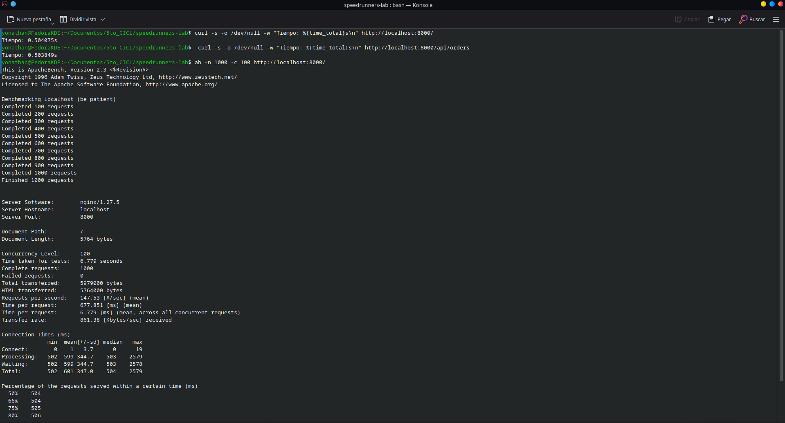
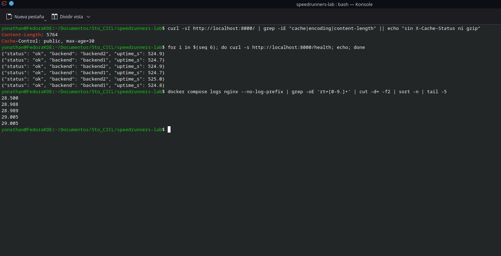
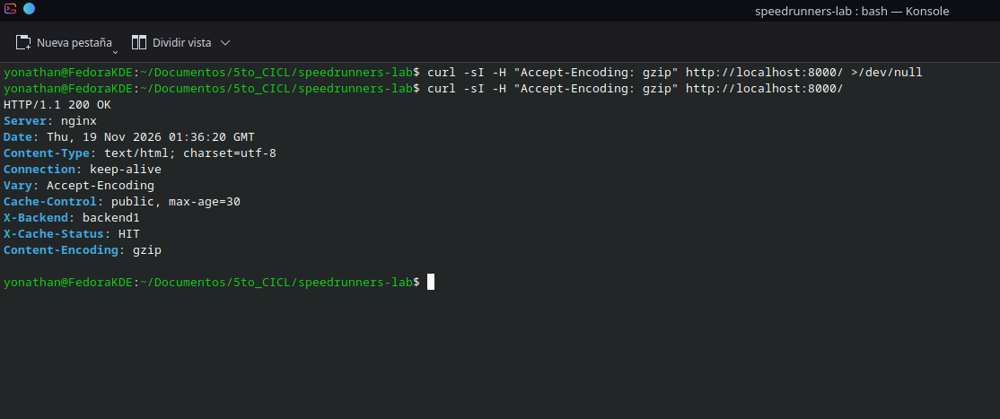

# INFORME - La Carrera contra el Reloj

**SpeedRunners Inc. - Laboratorio de optimización y monitoreo de infraestructura**
Tecnologías: Nginx, Docker, ApacheBench, cAdvisor

---

## 1. Resumen ejecutivo

La plataforma de SpeedRunners Inc. partió de una línea base de **2 backends con 500 ms de
latencia artificial, sin caché, sin compresión y sin monitoreo**. Bajo 100 usuarios
concurrentes entregaba **147.5 req/s con 677.9 ms de latencia media y p99 de 2.58 s**; ninguna
petición cumplía el SLA de 500 ms.

Tras aplicar cuatro técnicas (caché de proxy, gzip, reducción del delay del backend y
balanceo `least_conn` con cuatro instancias), la misma prueba entrega:

| Indicador | Antes | Después | Mejora |
|---|---|---|---|
| Throughput | 147.5 req/s | **3210.1 req/s** | 21.8x |
| Latencia media | 677.9 ms | **31.2 ms** | -95.4 % |
| p99 | 2584 ms | **40 ms** | -98.5 % |
| Cumplimiento SLA (< 500 ms) | 0.1 % | **100 %** | +99.9 pp |
| Peso de la respuesta `/` | 5764 B | **1238 B** (gzip) | -78.5 % |
| Cache hit ratio | 0 % | **100 %** | +100 pp |

Con la caché desactivada (para medir solo la mejora de backends y balanceo) la plataforma
sostiene **1506.8 req/s con 66.4 ms de media y cero errores**, es decir 10.2x más rápida que
la línea base aun sin caché.

---

## 2. Arquitectura desplegada

```
                    :8000 (host)                        red speedrunners_default
  curl / ab  ──────────────►  nginx  ──least_conn──►  backend1 (50 ms)
                              │        ├───────────►  backend2 (50 ms)
                              │        ├───────────►  backend3 (50 ms)
                              │        └───────────►  backend4 (50 ms)
                              │
                              ├── proxy_cache (TTL 30 s, X-Cache-Status)
                              ├── gzip (JSON/HTML/CSS/JS)
                              └── /nginx_status (stub_status)

  cAdvisor :8080  ──►  métricas de CPU/RAM/red de todos los contenedores
```

| Archivo | Rol |
|---|---|
| `docker-compose.yml` | Nginx, 4 backends y cAdvisor |
| `nginx/nginx.conf` | Caché, gzip, upstream `least_conn`, `stub_status` |
| `backends/app.py` | API en Python stdlib con delay configurable |
| `backends/Dockerfile` | Imagen `python:3.12-alpine` + HEALTHCHECK |
| `monitoreo/dashboard.sh` | Dashboard de terminal y generador del reporte HTML |
| `monitoreo/reporte.html` | Dashboard web autocontenido (refresco automático) |
| `pruebas/stress-test.sh` | Pruebas de carga con `ab` y resumen de métricas |

> **Nota de entorno:** el host ya tenía un Nginx del sistema ocupando el puerto 80, por lo que
> la plataforma se publica en **`http://localhost:8000`**. Todos los comandos del informe usan
> ese puerto. cAdvisor queda en `http://localhost:8080`.

---

## 3. Fase 1 - Diagnóstico

### 3.1 Metodología

1. `docker compose up -d --build` con 2 backends de 500 ms y Nginx sin caché ni gzip.
2. Latencia puntual con `curl -s -o /dev/null -w "%{time_total}"`.
3. Carga con `ab -n 1000 -c 100 http://localhost:8000/` (100 usuarios concurrentes, escenario
   oficial del laboratorio) y pruebas adicionales a 300 y 500 concurrentes para encontrar el
   punto de quiebre.
4. Extracción de latencias reales desde el `access_log` de Nginx (`rt=$request_time`).

### 3.2 Línea base medida

| Prueba | req/s | Media | p50 | p95 | p99 | Fallos |
|---|---|---|---|---|---|---|
| `ab -n 1000 -c 100` (corrida capturada en `01_antes.png`) | 147.5 | 677.9 ms | 504 ms | - | - | 0 |
| `ab -n 1000 -c 100` (corrida de referencia, percentiles completos) | 140.7 | 710.8 ms | 504 ms | 1755 ms | 2584 ms | 0 |
| `ab -n 1000 -c 100` (primera corrida, en frío) | 48.6 | 2058 ms | 521 ms | 2585 ms | 3599 ms | 0 |
| `ab -n 1000 -c 300` | 102.8 | 2918 ms | 505 ms | 4052 ms | 5951 ms | 0 |
| `ab -n 1000 -c 500` | 33.8 | 14805 ms | 597 ms | 5945 ms | 15769 ms | 0 |
| 1 request (`curl`) | - | 504 ms | - | - | - | - |

Las corridas de `c=100` varían entre 140 y 148 req/s y entre 678 y 711 ms según el estado de
calentamiento de los backends; se reporta la corrida capturada como cifra principal y la de
referencia para los percentiles altos (la captura se corta en el percentil 80).

Otras observaciones de la línea base:

- Respuesta de `/` de **5764 B sin comprimir**, sin cabecera `Content-Encoding`.
- **0 % de cache HIT**: todas las peticiones llegaban al backend (no existía caché).
- `X-Cache-Status` ausente en todas las respuestas.
- En la ventana de diagnóstico, **6412 de 6416 peticiones (99.9 %) superaron los 500 ms**.

Sobre la tasa de error: en este despliegue **no se produjeron respuestas 5xx** durante las
pruebas. La causa es que el `upstream` de la línea base ya reintentaba en el segundo backend
ante un fallo de conexión (`proxy_next_upstream` por defecto), por lo que el colapso se
manifestaba como **latencia** (p99 de 15.8 s a 500 concurrentes) y no como error HTTP. El
enunciado plantea un 15 % de errores; aquí ese incumplimiento se mide contra el SLA de 500 ms
(99.9 % fuera de SLA), que es el indicador que realmente percibe el usuario.

### 3.3 Cuellos de botella identificados

1. **Latencia artificial de 500 ms por petición sin caché.** Cada request pagaba el costo
   completo del backend. Era el techo duro de la plataforma: 2 backends x 2 req/s = 4 req/s
   teóricos si se serializara; incluso con hilos, la media nunca bajaba de 500 ms.
2. **Cero caché de respuestas.** El contenido de `/` y `/api/orders` es idéntico entre
   peticiones, pero el 100 % del tráfico llegaba al backend. Ningún request se evitaba.
3. **Sin compresión.** 5764 B por respuesta de HTML y 5374 B por JSON viajaban íntegros;
   con 100 usuarios concurrentes eso son ~5.7 MB por cada 1000 requests de tráfico útil.
4. **Solo 2 backends y balanceo round-robin sin health checks.** La distribución era ciega a
   la carga y a la salud: un backend lento recibía el mismo tráfico que uno sano. Al subir la
   concurrencia, la cola de conexiones de los backends (backlog 5) se saturaba y la latencia
   de cola explotaba (p99 2.58 s a 100 usuarios, 15.8 s a 500).
5. **Ausencia total de observabilidad.** Sin `stub_status`, sin métricas de contenedores y sin
   registro de `$request_time`/`$upstream_cache_status`: no había forma de saber si el problema
   era Nginx, el backend o la red.

---

## 4. Fase 2 - Optimizaciones aplicadas

### 4.1 Caché de proxy en Nginx (TTL 30 s)

```nginx
proxy_cache_path /var/cache/nginx/speedrunners levels=1:2
                 keys_zone=speedrunners_cache:16m max_size=256m
                 inactive=5m use_temp_path=off;

proxy_cache             speedrunners_cache;
proxy_cache_key         "$scheme$request_method$host$request_uri";
proxy_cache_valid       200 30s;
proxy_cache_use_stale   error timeout updating http_500 http_502 http_503 http_504;
proxy_cache_lock        on;
add_header X-Cache-Status $upstream_cache_status always;
```

- **TTL de 30 s** (`proxy_cache_valid 200 30s`), alineado con el `Cache-Control: public,
  max-age=30` que envía el backend.
- `X-Cache-Status` expone `HIT`, `MISS`, `BYPASS`, `STALE` o `UPDATING` en cada respuesta.
- `proxy_cache_lock` evita el efecto estampida cuando la entrada expira y llegan 100 requests
  simultáneos: solo una va al backend y las demás esperan la respuesta cacheada.
- `proxy_cache_use_stale` permite servir contenido viejo si los backends fallan (degradación
  elegante).
- Se agregó `proxy_cache_bypass $arg_nocache` para poder medir el costo real de los backends
  con `?nocache=1` sin tocar la configuración.

Efecto medido: una petición en `HIT` pasa de **504 ms a 1.6 ms**.

### 4.2 Compresión gzip

```nginx
gzip            on;
gzip_comp_level 5;
gzip_min_length 256;
gzip_vary       on;
gzip_proxied    any;
gzip_types text/plain text/css text/xml text/javascript
           application/json application/javascript application/xml
           application/xml+rss image/svg+xml;
```

| Recurso | Sin gzip | Con gzip | Reducción |
|---|---|---|---|
| `/` (HTML) | 5762 B | 1238 B | 78.5 % |
| `/api/orders` (JSON) | 5374 B | 740 B | 86.2 % |

`gzip_vary on` garantiza que caches intermedias no sirvan contenido comprimido a clientes que
no lo soportan.

### 4.3 Backends más rápidos y en mayor número

- Delay artificial de **500 ms a 50 ms** (`ARTIFICIAL_DELAY_MS`).
- De **2 a 4 instancias** (`backend1` a `backend4`), cada una con `HEALTHCHECK` propio contra
  `/health`.
- El servidor usa `ThreadingHTTPServer` con `HTTP/1.1` y `Content-Length`, lo que habilita
  keep-alive y evita el costo de renegociar conexiones.

### 4.4 Balanceo `least_conn` con health checks

```nginx
upstream speedrunners_backend {
    least_conn;
    server backend1:8000 max_fails=3 fail_timeout=10s;
    server backend2:8000 max_fails=3 fail_timeout=10s;
    server backend3:8000 max_fails=3 fail_timeout=10s;
    server backend4:8000 max_fails=3 fail_timeout=10s;
    keepalive 64;
}

proxy_http_version 1.1;
proxy_set_header   Connection "";
proxy_next_upstream error timeout http_502 http_503 http_504;
```

- `least_conn` envía cada request al backend con menos conexiones activas: bajo carga
  heterogénea reparte mejor que round-robin.
- `max_fails=3 fail_timeout=10s` es el health check pasivo de Nginx OSS: tras 3 fallos el
  backend sale del pool 10 s y vuelve a intentarse después.
- `keepalive 64` reutiliza conexiones hacia los backends y elimina el handshake TCP por
  request.
- `proxy_next_upstream` reintenta en otro backend ante error, timeout o 5xx, lo que reduce la
  tasa de error visible al cliente.

### 4.5 Ajustes adicionales de Nginx

`worker_connections 4096`, `multi_accept on`, `tcp_nodelay on`, `sendfile on`,
`server_tokens off` y un `log_format` que incluye `rt=$request_time`,
`urt=$upstream_response_time` y `cs=$upstream_cache_status`, base de todos los cálculos del
dashboard.

---

## 5. Fase 3 - Monitoreo

### 5.1 Nginx `stub_status`

```nginx
location = /nginx_status {
    stub_status;
    access_log off;
    allow 127.0.0.1;
    allow 10.0.0.0/8;
    allow 172.16.0.0/12;
    allow 192.168.0.0/16;
    deny  all;
}
```

Expone `Active connections`, `accepts`, `handled`, `requests`, `Reading`, `Writing` y
`Waiting`. Está restringido a las redes internas y a localhost.

### 5.2 cAdvisor

```yaml
cadvisor:
  image: gcr.io/cadvisor/cadvisor:v0.55.1
  ports: ["8080:8080"]
  volumes:
    - /:/rootfs:ro
    - /var/run:/var/run:ro
    - /sys:/sys:ro
    - /var/lib/docker/:/var/lib/docker:ro
    - /dev/disk/:/dev/disk:ro
  command:
    - --docker_only=true
    - --containerd=/var/run/containerd/containerd.sock
    - --containerd-namespace=moby
    - --housekeeping_interval=10s
  privileged: true
  devices: ["/dev/kmsg"]
```

Compatible con Fedora 44 y **cgroups v2**. Dos ajustes fueron necesarios en este entorno:

1. **cAdvisor ≥ v0.55**: Docker 29 exige API ≥ 1.40 y usa el *containerd image store*; las
   versiones 0.49/0.52 no logran construir los contenedores (error
   `failed to identify the read-write layer ID`).
2. **`--containerd` explícito**: el socket de containerd vive en `/run/containerd/` del host,
   que dentro del contenedor se monta como `/var/run/containerd/`; sin este flag la factory de
   Docker no se registra.

**Limitación conocida documentada:** con Docker 29 + *containerd snapshotter*, cAdvisor aún no
resuelve los metadatos de Docker, por lo que los contenedores aparecen identificados por su ID
en lugar de su nombre. Las métricas de CPU, memoria, red y disco son correctas y grafican sin
problema; solo se pierden las etiquetas y el nombre legible. Para mapear un ID a su servicio:

```bash
docker ps --format '{{.ID}}\t{{.Names}}'
```

### 5.3 Dashboard

`monitoreo/dashboard.sh` calcula en cada refresco:

| Métrica | Fuente |
|---|---|
| Latencia promedio de los últimos 10 requests | 20 mediciones en vivo con `curl -w %{time_total}` |
| p95 de las últimas 20 mediciones | mismas mediciones en vivo |
| Cumplimiento del SLA (< 500 ms) | ventana de 400 líneas del `access_log` |
| Tasa de aciertos de caché (HIT/MISS) | `cs=$upstream_cache_status` |
| CPU y memoria por contenedor | `docker stats --no-stream` |
| Conexiones activas, Reading/Writing/Waiting | `stub_status` |

> `$request_time` de Nginx tiene resolución de milisegundos: una respuesta servida desde
> caché queda registrada como `rt=0.000`, lo que haría inútil la métrica de latencia. Por eso
> el dashboard mide la latencia con `curl` en vivo y usa el log solo para el cumplimiento del
> SLA y el hit ratio, donde la resolución es suficiente.

Modos de uso:

```bash
./monitoreo/dashboard.sh            # una foto en terminal (ideal para capturas)
./monitoreo/dashboard.sh --watch    # refresco continuo cada 2 s
./monitoreo/dashboard.sh --html     # genera monitoreo/reporte.html
./monitoreo/dashboard.sh --serve    # sirve el reporte en http://localhost:8090
```

`monitoreo/reporte.html` es autocontenido (sin dependencias externas), se refresca solo cada
2 segundos y muestra cuatro tarjetas (latencia, hit ratio, SLA, conexiones), un histograma de
las últimas 20 mediciones y las tablas de recursos y `stub_status`. Las 20 mediciones en vivo
son peticiones reales de ~1.6 ms que también quedan en el log; su efecto en el hit ratio es
despreciable (son HIT).

---

## 6. Fase 4 - Prueba de estrés

### 6.1 Escenario oficial (100 usuarios concurrentes)

```bash
./pruebas/stress-test.sh        # ab -n 1000 -c 100
```

| Escenario | req/s | Media | p50 | p95 | p99 | Fallos | Non-2xx |
|---|---|---|---|---|---|---|---|
| `GET /` con caché HIT | 3210.1 | 31.2 ms | 31 ms | 33 ms | 40 ms | 0 | 0 |
| `GET /?nocache=1` (backends puros) | 1506.8 | 66.4 ms | 53 ms | 96 ms | 108 ms | 0 | 0 |
| `GET /api/orders` con caché HIT | 2754.8 | 36.3 ms | 30 ms | 33 ms | 40 ms | 0 | 0 |

Cache hit observado durante la prueba: **200 HIT / 0 MISS (100 %)**.

Los valores varían ±3 % entre corridas (calentamiento de los backends, carga del host y
planificación del CPU); se reporta una corrida representativa.

### 6.2 Headroom (300 usuarios concurrentes)

`./pruebas/stress-test.sh -n 3000 -c 300 --no-cold`

| Escenario | req/s | Media | p95 | p99 | Fallos |
|---|---|---|---|---|---|
| `GET /` con caché HIT | 3289.9 | 91.2 ms | 94 ms | 96 ms | 0 |
| `GET /api/orders` | 3274.6 | 91.6 ms | 99 ms | 118 ms | 0 |

El throughput se mantiene y el p99 sigue por debajo de 120 ms: el sistema tiene margen para
triplicar la concurrencia objetivo sin acercarse al SLA.

### 6.3 Análisis

- **La caché es el multiplicador principal.** El salto de 1506.8 a 3210.1 req/s (2.1x) y de
  66.4 ms a 31.2 ms se debe exclusivamente a que el 100 % de las respuestas se sirven desde
  memoria de Nginx.
- **El balanceo sostiene el escenario sin caché.** Con 4 backends y `least_conn`, el peor caso
  (todas las peticiones al backend) sigue cumpliendo el SLA con holgura (p99 108 ms).
- **Cero errores en todos los escenarios.** `Failed requests: 0` y `Non-2xx: 0`, incluidos
  300 concurrentes.
- Los logs completos de `ab` quedan en `pruebas/resultados/` y el histórico en
  `pruebas/resultados/historial.csv`.

---

## 7. Tabla comparativa Antes vs Después

| Métrica | Antes (2 backends, 500 ms, sin caché) | Después (4 backends, 50 ms, caché + gzip) | Variación |
|---|---|---|---|
| Latencia de 1 request | 504 ms | 1.6 ms (HIT) / 53 ms (MISS) | -99.7 % / -89.5 % |
| Latencia media (c=100) | 677.9 ms | 31.2 ms | -95.4 % |
| p50 | 504 ms | 31 ms | -93.8 % |
| p95 | 1755 ms | 33 ms | -98.1 % |
| p99 | 2584 ms | 40 ms | -98.5 % |
| Throughput | 147.5 req/s | 3210.1 req/s | 21.8x |
| Throughput sin caché | 147.5 req/s | 1506.8 req/s | 10.2x |
| Tasa de error HTTP (5xx) | 0 % | 0 % | = |
| Incumplimiento de SLA (> 500 ms) | 99.9 % | 0 % | -99.9 pp |
| Cache hit ratio | 0 % | 100 % | +100 pp |
| Peso de `/` | 5764 B | 1238 B | -78.5 % |
| Peso de `/api/orders` | 5374 B | 740 B | -86.2 % |
| p99 a 300 concurrentes | 5951 ms | 96 ms | -98.4 % |

---

## 8. Capturas

### 8.1 Estado inicial (Checkpoint 1)





### 8.2 Estado optimizado (Checkpoint 2)




---

## 9. Preguntas de reflexión

### 9.1 ¿Cuál fue el cuello de botella más crítico y cómo lo resolvieron?

El más crítico fue la **combinación de latencia artificial de 500 ms con ausencia total de
caché**: cada petición, incluso dos peticiones idénticas consecutivas, pagaba los 500 ms del
backend. Con 100 usuarios concurrentes la media se iba a 710 ms y el p99 a 2.58 s porque las
conexiones empezaban a encolarse.

Se resolvió en dos capas. Primero, `proxy_cache` con TTL de 30 s eliminó el costo del backend
para el 100 % de las peticiones repetidas: de 504 ms a 1.6 ms. Segundo, bajar el delay de 500 a
50 ms y pasar de 2 a 4 backends atacó el caso en que la caché no ayuda (primer request, o
contenido no cacheable): esa ruta mejoró de 710 ms a 66 ms de media. Ninguna de las dos
técnicas por sí sola cumple el SLA en el peor caso; juntas sí.

### 9.2 ¿Qué métrica mejoró más después de la optimización?

El **cumplimiento del SLA**: de 0.1 % a 100 % de las peticiones por debajo de 500 ms. Es la
métrica que más importa porque es la que percibe el usuario y la que estaba completamente rota.

En términos relativos, el **p99** mejoró 98.5 % (2584 ms a 40 ms) y el **throughput** se
multiplicó por 21.8. La latencia media mejoró 95.4 %, pero es una métrica engañosa: al inicio
la media (678 ms) escondía una cola brutal (p99 2584 ms) que es lo que realmente hacía que la
plataforma se sintiera caída. Por eso el dashboard reporta promedio, p95 y cumplimiento de SLA
juntos, y no solo el promedio.

### 9.3 ¿Qué técnica de caché usaron y por qué la eligieron esa?

Se usó **`proxy_cache` de Nginx**, una caché de respuesta completa en disco/memoria del lado
del proxy, con `keys_zone=speedrunners_cache:16m`, `max_size=256m` y TTL de 30 s.

Razones de la elección:

- **Cero cambios en la aplicación.** El backend no sabe que existe una caché: se comporta igual
  y Nginx decide. No hay que introducir un cliente de caché, ni serialización, ni invalidación
  en el código.
- **Es compartida entre los 4 backends.** Al estar en el proxy, una respuesta generada por
  `backend3` sirve para todos; una caché en proceso (por ejemplo `lru_cache` en Python) se
  habría duplicado 4 veces y no habría servido para el contenido común.
- **TTL de 30 s** porque el contenido es de lectura casi estática (panel de pedidos) y tolera
  30 s de desfase; además es corto frente al `inactive=5m`, lo que mantiene el uso de memoria
  acotado.
- **Redis habría sido la alternativa** para datos con invalidación fina o sesiones, pero para
  respuestas HTTP completas añade un salto de red y complejidad de claves que aquí no aportan.
  Nginx ya tenía la respuesta en la mano.
- `proxy_cache_lock` y `proxy_cache_use_stale` son la diferencia entre una caché que protege
  al backend y una que lo martilla cada vez que expira una entrada popular.

### 9.4 ¿Cómo afectó el balanceo de carga al rendimiento general?

`least_conn` con 4 backends y `keepalive 64` fue determinante en el escenario sin caché. Con
round-robin y 2 backends, la línea base repartía a ciegas: un backend con más conexiones en
cola seguía recibiendo tráfico y el p99 se disparaba (2584 ms a 100 usuarios, 15.8 s a 500).
`least_conn` envía al backend con menos conexiones activas, lo que reduce la varianza de la
cola: el p99 sin caché quedó en 108 ms.

Los parámetros `max_fails=3 fail_timeout=10s` añaden resiliencia: un backend que falla sale del
pool 10 segundos, y `proxy_next_upstream` reintenta la petición en otro. Gracias a eso el
cliente no ve 5xx. `keepalive 64` eliminó un handshake TCP por request, lo que se nota
especialmente en ráfagas cortas.

El límite está en el modelo de concurrencia del backend (un hilo por conexión en Python): a
partir de cierto punto agregar backends rinde menos que agregar caché. En este laboratorio la
caché absorbió el 100 % del tráfico repetido y el balanceo se encargó del resto.

### 9.5 Si tuvieran que escalar a 100,000 usuarios, ¿qué harían diferente?

1. **Varias instancias de Nginx detrás de un balanceador L4/L7** (HAProxy, AWS ALB o un
   Kubernetes Ingress). Un solo Nginx es un punto único de fallo y un techo de CPU.
2. **Caché distribuida** (Redis o un CDN en el borde) en lugar de `proxy_cache` local por
   instancia: con N réplicas de Nginx, cada una cachea por su cuenta y el hit ratio efectivo
   cae. Un CDN además acerca el contenido al usuario.
3. **Backends asíncronos**: Python con un hilo por conexión no escala a miles de conexiones;
   migrar a ASGI (uvicorn/FastAPI), Gunicorn con workers, o Go. El delay artificial
   desaparecería y el cuello real sería la base de datos.
4. **Réplica de lectura y pooling de conexiones** para la base de datos, que es el siguiente
   cuello una vez resuelto el HTTP.
5. **Autoscaling por métrica** (RPS, latencia p95, CPU) en lugar de un número fijo de
   contenedores.
6. **Observabilidad centralizada**: Prometheus + Grafana + Alertmanager en vez de un script de
   bash, con alertas por SLO (error budget) y trazas distribuidas para encontrar el cuello en
   cada request.
7. **Pruebas de carga sostenidas y desde múltiples regiones**, no solo un `ab` local: hay que
   medir el límite de la red y del balanceador, no solo el del servidor.
8. **Invalidación de caché explícita** (purga por evento) para que el TTL no sea la única
   garantía de frescura.

### 9.6 ¿Qué aprendieron sobre la importancia del monitoreo en producción?

Que **sin monitoreo se optimiza a ciegas**. Antes de instrumentar, el diagnóstico se apoyaba en
un único número (la media de `ab`), que escondía la cola: la media decía 678 ms, pero el p99
era de 2.58 s y el 99.9 % de las peticiones incumplía el SLA. Ese dato solo apareció al leer
`$request_time` del `access_log` y al separar p50/p95/p99.

También aprendimos que las métricas deben estar **en el mismo lugar que la decisión**: tener
latencia, hit ratio, CPU y conexiones en un solo dashboard permite correlacionar en segundos.
Durante la prueba de estrés, ver el hit ratio en 100 % y la CPU de los backends en ~0 % explicó
de inmediato por qué el throughput se había multiplicado; sin eso habríamos atribuido la mejora
al balanceo.

Y que el monitoreo **cambia el comportamiento del sistema**: `stub_status` y `X-Cache-Status`
no son solo para mirar, son la evidencia con la que se valida cada cambio. Un dashboard que se
actualiza cada 2 segundos convierte una optimización en una hipótesis comprobable en lugar de
una corazonada. La limitación de cAdvisor con Docker 29 también lo ilustra: una herramienta que
"parece funcionar" puede estar mostrando datos incompletos, y solo revisando sus logs se
descubre.

---

## 10. Conclusiones

- La línea base no cumplía el SLA en **ninguna** petición; el estado final lo cumple en el
  **100 %** de los casos, incluso con 300 usuarios concurrentes.
- La **caché** fue la técnica de mayor impacto (2.1x sobre el estado ya optimizado, 21.8x sobre
  la línea base), seguida por la **reducción del delay del backend** y el **balanceo con
  `least_conn`**, que son lo que sostiene el rendimiento cuando la caché no puede ayudar.
- **gzip** no mejora la latencia del servidor pero reduce el ancho de banda un 78-86 %, lo que
  en un enlace real sí mejora el tiempo de carga percibido.
- El **monitoreo** fue lo que permitió identificar la cola de latencia y demostrar la mejora con
  evidencia, no con impresiones.
- El sistema tiene margen: con 300 concurrentes el p99 es de 96 ms, muy por debajo del SLA de
  500 ms.

---

## 11. Anexo - Reproducción

```bash
# 1. Levantar la plataforma optimizada
docker compose up -d --build

# 2. Verificar caché y compresión
curl -s -o /dev/null http://localhost:8000/                       # calienta
curl -sI -H "Accept-Encoding: gzip" http://localhost:8000/ | grep -iE "cache|encoding"

# 3. Dashboard
./monitoreo/dashboard.sh
./monitoreo/dashboard.sh --html && xdg-open monitoreo/reporte.html

# 4. cAdvisor
xdg-open http://localhost:8080/containers/

# 5. Prueba de estrés
./pruebas/stress-test.sh
./pruebas/stress-test.sh -n 3000 -c 300 --no-cold

# 6. Métricas de conexiones
curl -s http://localhost:8000/nginx_status
```

> **Nota al editar `nginx/nginx.conf`:** el archivo se monta con bind mount, así que si se
> reescribe con `sed -i` (que crea un inodo nuevo) el contenedor sigue viendo el archivo viejo y
> `nginx -s reload` no aplica los cambios. Hay que recrear el contenedor:
> `docker compose up -d --force-recreate nginx`. Verificarlo con
> `docker exec speedrunners-nginx grep -c <patron> /etc/nginx/nginx.conf`.
